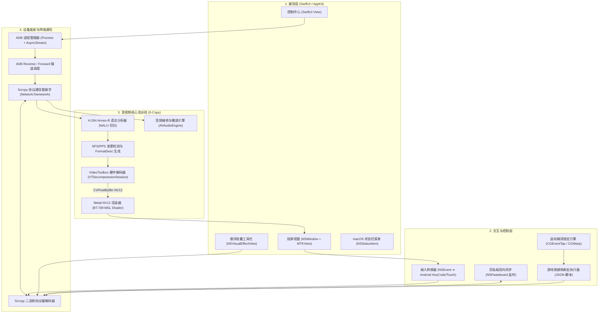
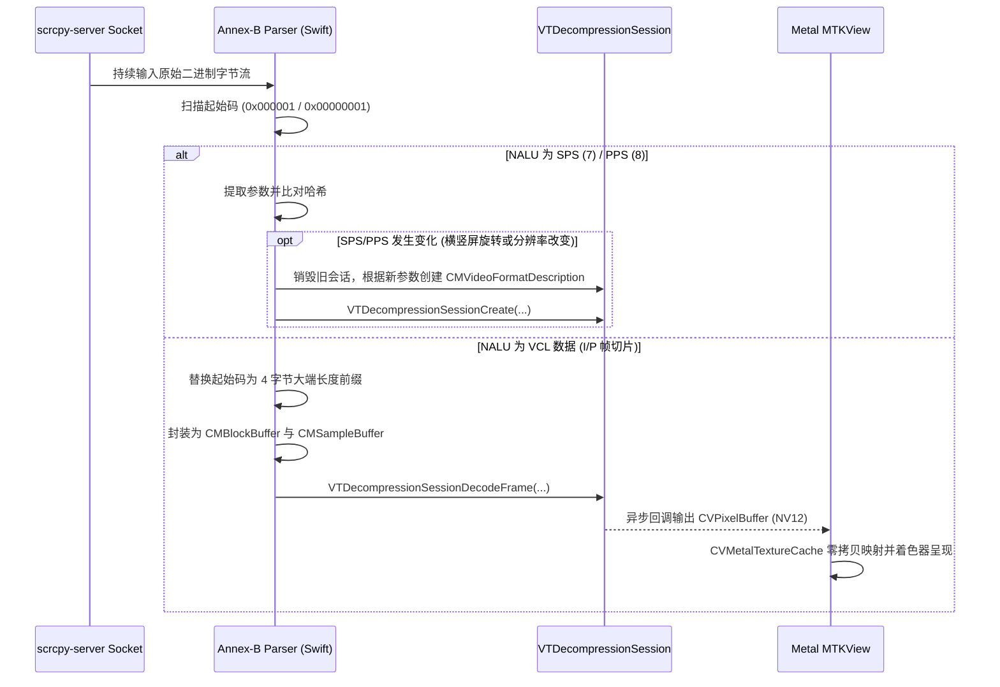

# MetalCast（Swift 原生重构版）完整落地方案与计划

> **项目目标**：抛弃 Qt 和 FFmpeg 等外部重型依赖，基于 **Swift + SwiftUI + AppKit + VideoToolbox + Metal** 打造 macOS 原生专享的 Android 投屏控制客户端，实现极小体积（< 15MB）、极速秒开、超低 CPU 占用（~3%-5%）以及极致流畅的交互体验。

---

## 一、 系统架构蓝图

整体架构分为 **展现层（UI Layer）**、**控制与交互层（Interaction Layer）**、**音视频流水线（Media Pipeline）** 以及 **设备与协议底座（Core & Network）** 四层：



---

## 二、 核心关键技术攻坚方案

### 1. 视频流从 Annex-B 到 VideoToolbox 的转换

`scrcpy-server` 输出的是标准的 Annex-B 裸码流，而 Apple `VideoToolbox` 只接受 AVCC（以 4 字节 Big-Endian 长度开头的 NALU）和包含 SPS/PPS 的 `CMVideoFormatDescription`。



#### 关键实现策略：
* **零内存分配扫描**：避免频繁分配 `Data` 对象，使用 Swift 指针直接在连续环形缓冲区（Ring Buffer）内寻找 `00 00 00 01` 起始码。
* **旋转安全重建**：当检测到 SPS 宽高变动时，不阻塞工作队列，异步拉起新的解码 Session，丢弃旧会话中残留的过期帧。

---

### 2. Metal NV12 零拷贝着色器渲染管线

为实现超低能耗，全链路必须基于 Apple Silicon 统一内存（UMA），严禁转成 RGB 图片：

1. **纹理缓存**：使用 `CVMetalTextureCacheCreateTextureFromImage`：
   * 绑定 **Plane 0**（亮度 Y 分量，格式 `r8Unorm`）
   * 绑定 **Plane 1**（色度 CbCr 分量，格式 `rg8Unorm`）
2. **Metal 着色器矩阵转换**：
   在 `.metal` 源码中内置标准 **BT.709 变换矩阵**：
   ```metal
   // Fragment Shader: YUV (NV12) -> RGB (BT.709)
   float y = yTexture.sample(textureSampler, in.texCoords).r;
   float2 uv = uvTexture.sample(textureSampler, in.texCoords).rg - float2(0.5, 0.5);
   
   float3 rgb;
   rgb.r = y + 1.5748 * uv.y;
   rgb.g = y - 0.1873 * uv.x - 0.4681 * uv.y;
   rgb.b = y + 1.8556 * uv.x;
   return float4(rgb, 1.0);
   ```
3. **抗积压丢帧机制（Anti-Jitter）**：
   在渲染端维护单个原子槽位 `atomicCurrentBuffer`。当网络或解码产生积压时，新到帧直接覆盖旧帧，确保**永远只渲染最新一帧**，将端到端延迟死死压在 35ms 左右。

---

### 3. ADB 托管与流式异步 I/O

解决 Swift `Process` 调用外部命令时容易发生的 **Pipe 缓冲区满挂起死锁**：

```swift
actor ADBProcessRunner {
    func execute(command: String, args: [String]) -> AsyncStream<String> {
        AsyncStream { continuation in
            let process = Process()
            let pipe = Pipe()
            process.standardOutput = pipe
            process.standardError = pipe
            
            // 必须使用流式异步回调，绝不能阻塞调用 readDataToEndOfFile()
            pipe.fileHandleForReading.readabilityHandler = { handle in
                let data = handle.availableData
                guard !data.isEmpty else { return }
                if let str = String(data: data, encoding: .utf8) {
                    continuation.yield(str)
                }
            }
            
            process.terminationHandler = { _ in
                pipe.fileHandleForReading.readabilityHandler = nil
                continuation.finish()
            }
            try? process.run()
        }
    }
}
```

* **环境回退链**：内置 `/Resources/adb` ➔ 用户环境变量 `$PATH` ➔ `~/Library/Android/sdk/platform-tools/adb` ➔ Homebrew 路径 `/opt/homebrew/bin/adb`。
* **隧道建立策略**：优先尝试 `adb reverse localabstract:scrcpy tcp:27183`，若失败则自动优雅降级为 `adb forward tcp:27183 localabstract:scrcpy`。

---

### 4. 键鼠与控制协议编码

Scrcpy 通信是纯大端二进制格式。Swift 中通过轻量值类型进行封包：

```swift
enum ControlMessageType: UInt8 {
    case injectTouch = 2
    case injectKeycode = 0
    case injectText = 1
    case setScreenPower = 14
}

struct ScrcpyTouchMessage {
    let action: UInt8         // 0: Down, 1: Up, 2: Move
    let pointerId: UInt64     // 手指 ID
    let x: UInt32             // 手机绝对分辨率坐标 X
    let y: UInt32             // 手机绝对分辨率坐标 Y
    let screenWidth: UInt16
    let screenHeight: UInt16
    
    func serialize() -> Data {
        var data = Data()
        data.append(ControlMessageType.injectTouch.rawValue)
        data.append(action)
        data.append(contentsOf: pointerId.bigEndian.bytes)
        data.append(contentsOf: x.bigEndian.bytes)
        data.append(contentsOf: y.bigEndian.bytes)
        data.append(contentsOf: screenWidth.bigEndian.bytes)
        data.append(contentsOf: screenHeight.bigEndian.bytes)
        return data
    }
}
```

* **中文输入法支持**：投屏视窗继承 `NSTextInputClient`，拦截最终确定的输入法汉字，直接转为 `injectText` 消息注入手机，彻底解决拼音拆字乱码问题。
* **鼠标锁定模式**：针对 FPS 游戏，调用 `CGAssociateMouseAndMouseCursorPosition(false)` 锁定光标，并通过 `CGWarpMouseCursorPosition` 将指针锁在视窗中心，捕捉相对增量并映射为视角滑动。

---

## 三、 工程目录结构规划

采用模块化 SPM（Swift Package Manager）组织核心库与应用主工程：

```
MetalCast/
├── Package.swift                       // 核心依赖管理
├── App/                                // macOS 主应用工程
│   ├── MetalCastApp.swift              // 声明 SwiftUI App 与 MenuBar 状态栏
│   ├── Assets.xcassets                 // SF Symbols 与应用图标
│   └── Info.plist                      // 辅助功能/本地网络权限说明
├── Sources/
│   ├── MetalCastCore/                  // 底层核心驱动库
│   │   ├── ADB/                        // ADB 服务发现、执行、端口转发
│   │   ├── Protocol/                   // Scrcpy 控制报文编解码器
│   │   └── Network/                    // Network.framework TCP 客户端/服务端
│   ├── MetalCastMedia/                 // 音视频流水线
│   │   ├── Parser/                     // Annex-B 切分器与 SPS/PPS 检测器
│   │   ├── Decoder/                    // VideoToolbox 硬解引擎
│   │   ├── Render/                     // Metal 着色器 (.metal) 与 MTKView 视窗
│   │   └── Audio/                      // AVAudioEngine 实时音频播放
│   └── MetalCastUI/                    // 界面与交互层
│       ├── Dashboard/                  // 主控制面板 (SwiftUI)
│       ├── Mirror/                     // 投屏视窗 (NSWindowController)
│       ├── Components/                 // 悬浮胶囊栏、分段控制器、状态指示灯
│       └── Interaction/                // 键盘映射、鼠标锁定、拖拽接收器
└── Resources/
    ├── scrcpy-server                   // Android 服务端预编译 jar 包
    └── adb                             // 内置 macOS arm64 架构 ADB 二进制
```

---

## 四、 研发实施里程碑规划（聚焦核心投屏体验）

> **战略重点（v1.0）**：集中精力将基础投屏、剪贴板、文件传输、息屏控制与能效做到行业天花板级别；复杂的 FPS 键鼠锁定与自定义映射脚本顺延至 v1.1 专版迭代。

| 阶段 | 周期 | 核心目标 | 验收交付物 |
| :--- | :---: | :--- | :--- |
| **M1: 通讯与隧道连通** | 第 1 周 | ADB 设备热插拔扫描、scrcpy-server 自动注入、TCP 隧道打通 | 控制中心自动发现 USB/Wi-Fi 设备，成功启动 server 并握手建立 Socket |
| **M2: 视频流硬解与上屏** | 第 2 周 | Annex-B 实时切分、VideoToolbox 硬解、Metal NV12 零拷贝渲染 | 手机画面在 Mac 上以 60/120fps 显示，端到端延迟 < 40ms，CPU 占用 < 5% |
| **M3: 控制与全自动同步** | 第 3 周 | 触控/鼠标注入、双向无感剪贴板（NSPasteboard）、物理息屏控制 | 鼠标点击滑动精准流畅，剪贴板自动同步，一键息屏降温且后台投屏不中断 |
| **M4: 拖拽传输与原生界面** | 第 4 周 | 拖入 APK 静默安装、拖入文件推流至 Download、SwiftUI 控制台与胶囊工具栏 | 现代化原生视觉效果，拖拽传输与截图录屏全功能闭环 |
| **M5: 极致性能调优与发布** | 第 5 周 | 自适应抗积压防延迟丢帧、统一内存优化、Notarization 签名公证与 DMG 打包 | 产生免安装独立 DMG 发布包，内存占用 < 80MB，无发热卡顿 |
| **v1.1+ (后续扩展)** | 规划中 | 游戏键鼠映射宏（FPS 准星锁定、WASD 移动、可视化 HUD 映射） | 针对手游爱好者的端游级体验扩展 |

---

## 五、 潜在风险与应对预案

> [!IMPORTANT]
> 1. **权限体验**：全局鼠标劫持（FPS 模式）依赖「辅助功能」与「输入监听」权限。
>    * **预案**：设计友好的首次运行权限引导向导（Onboarding Wizard），一键唤起系统设置页面。
> 2. **Android 10+ 后台剪贴板限制**：Android 10 之后非前台应用默认无法静默读取剪贴板。
>    * **预案**：通过 `scrcpy-server` 自身拥有的 `shell` 级别特权调用系统 hidden API 读取，避免手机端受限。
> 3. **网络抖动与累积延迟**：无线 Wi-Fi 投屏在信道拥挤时可能出现突发数据堆积。
>    * **预案**：内置自适应帧缓冲机制，检测到接收队列超过 2 帧即自动丢弃非关键帧，严保实时交互手感。
